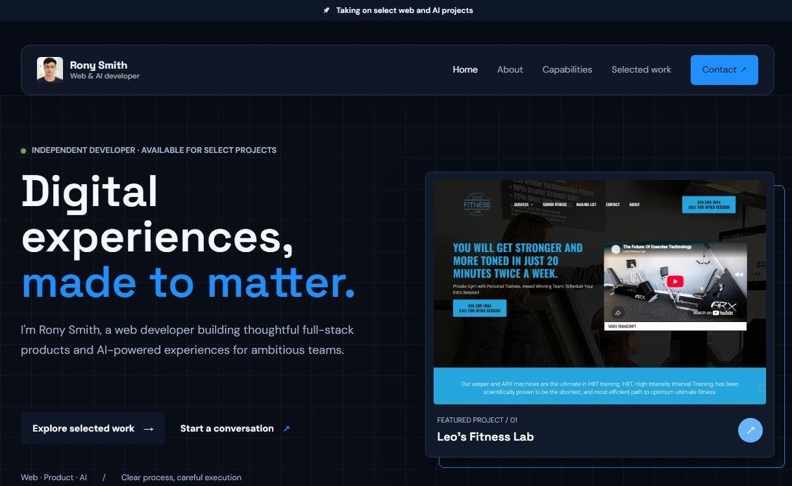

# 👋 Rony Smith | Portfolio

A responsive, single-page portfolio for Rony Smith, a web and AI developer. It introduces his work, highlights selected client projects, and gives visitors a way to get in touch.

<p align="center">
  
</p>

## 🧭 What's on the page

- 🏠 **Home:** introduction, availability, and featured project.
- 👤 **About:** a short profile and photo.
- 🛠️ **Capabilities:** technologies and tools.
- 💼 **Selected work:** a keyboard-accessible project carousel with links to live sites.
- ✉️ **Contact:** a message form and direct email link.

The layout adapts to mobile screens and includes a mobile navigation menu, scroll animations, and a back-to-top button.

## 🖥️ Preview locally

This is a static website: there is no package installation, build step, or framework. You can open `index.html` in a browser, or serve the project root locally:

```bash
python -m http.server 8000
```

Then visit [http://localhost:8000](http://localhost:8000). The page loads fonts, AOS, and Swiper from external CDNs, so an internet connection is needed for those features.

## 📬 Contact

- 📧 **Email:** [ronysmith@gmail.com](mailto:ronysmith@gmail.com)
- 📅 **Schedule a conversation:** [Calendly](https://calendly.com/smithrony0619/)
- 🐙 **GitHub:** [github.com/smithrony0619](https://github.com/smithrony0619)
- Or send a message using the contact form on the portfolio.

## 🧰 My skills

I build responsive, end-to-end web products, combining front-end development with back-end services, data, and AI integrations.

- 🎨 **Front end:** HTML, CSS, JavaScript, Tailwind CSS, React, Next.js, Astro
- ⚙️ **Back end:** Node.js, Python
- 🗄️ **Database:** MongoDB, My SQL, PostgreSQL
- 🔧 **Tools:** Git, GitHub
- 🤖 **AI:** AI-powered features and integrations

## 🚀 Selected projects

- 💪 [Leo's Fitness Lab](https://leofitlabs.com/)
- 💻 [Xan Systems](https://xansystems.com/)
- 📈 [Luxury Consulting Online](https://luxuryconsultingonline.com/)
- 🎨 [Senestudio](https://senestudio.com/)

## 📚 Libraries and services

- ✨ [AOS](https://michalsnik.github.io/aos/) for scroll-triggered animations.
- 🎠 [Swiper](https://swiperjs.com/) for the selected-work carousel.
- 🔤 [Google Fonts](https://fonts.google.com/) for DM Sans and Space Grotesk.
- 📨 [FormSubmit](https://formsubmit.co/) for contact-form delivery.

These are loaded from their hosted services; the project does not bundle them locally.

## ☁️ Deployment

Deploy the repository root to any static web host, such as GitHub Pages. No build command is required. Ensure the host serves `index.html` from the root and preserves the `src/` asset paths. If using a custom domain, update `CNAME` to the domain you control or remove it when it is not needed.

## 📄 License

This project is released under the MIT License. See [LICENSE](./LICENSE).
